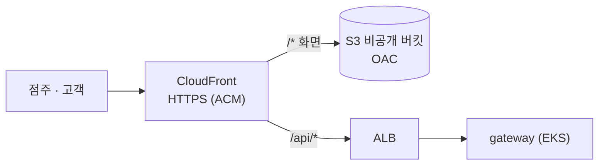

# frontend

> FreshLink의 **화면**. 점주 화면(`/owner`, 매장 포스기)과 고객 화면(`/customer`, 핸드폰)을 React 앱 하나에 담고, 라우팅으로 나눈다.

| 항목 | 내용 |
| --- | --- |
| 담당 | 공통 (레이아웃·라우팅: 김진아, 점주 재고 화면: 이태우, 로그인·고객 주문 화면: 김경우) |
| 기술 | Vite, React, TypeScript, React Router, Tailwind CSS, TanStack Query, axios, Zustand, Amazon Cognito(aws-amplify) ([전체 목록과 이유](docs/tech-stack.md)) |
| 배포 | `main` 합치기 → GitHub Actions `npm run build` → S3 업로드 → CloudFront 캐시 무효화 |
| 접속 | CloudFront 주소 하나 (화면 `/*` → S3, API `/api/*` → EKS gateway) |

## 기술 스택


| 영역 | 사용 | 한 줄 이유 |
| --- | --- | --- |
| 빌드·언어 | Vite, React 19, TypeScript | 빌드 결과를 그대로 S3에 올리고, API·토큰 모양을 타입으로 맞춘다 |
| 라우팅 | React Router | `/owner`·`/customer`를 한 앱에서 나누고 역할(OWNER/CUSTOMER) 가드를 건다 |
| 스타일 | Tailwind CSS v4, lucide-react, clsx + tailwind-merge | 포스기(가로)·핸드폰(세로) 화면을 클래스만으로 빠르게 맞춘다 |
| 서버 데이터 | TanStack Query, axios | 점주 재고 3초·주문 상세 2초 폴링, `/api` 호출과 토큰 첨부를 한 곳에서 |
| 로그인 | Amazon Cognito (aws-amplify), Zustand | 가입·로그인·토큰 갱신은 Cognito가, 화면은 로그인한 사용자 정보만 Zustand로 본다 |
| 폼·알림 | react-hook-form + zod, sonner, dayjs | 입력 검증, 토스트 알림, 유통기한 계산 |
| 결제 | 토스페이먼츠 SDK | 테스트 결제(U-21, U-22) |
| 개발·테스트 | MSW, Vitest + Testing Library, oxlint, Prettier | 백엔드 없이 가짜 API로 개발하고, 가드·핵심 로직을 테스트한다 |

라이브러리별 자세한 이유, 넣지 않은 것, 실시간 재고를 SSE 대신 폴링으로 한 이유, Cognito 로그인 흐름은 [docs/tech-stack.md](docs/tech-stack.md)에 있다.

---

## 1. FreshLink는 무엇인가

편의점 점주와 고객이 **같은 재고 데이터**를 보는 서비스다. 고객이 결제하면 점주 화면의 재고가 그 자리에서 줄고, 유통기한이 지난 상품은 고객에게 보이지 않는다. 전체 소개는 [Organization README](https://github.com/sesac-freshlink)를 참고한다.

## 2. 배포 구조



화면과 API를 **같은 CloudFront 주소**로 묶었기 때문에 **CORS 설정이 필요 없다.** 프론트에서는 API를 항상 상대 경로 `/api/...`로 부른다.

주의할 점:

1. **새로고침:** `/owner/inventory`에서 새로고침해도 깨지지 않도록 CloudFront Function이 확장자 없는 경로를 `/index.html`로 바꿔 준다([infra](https://github.com/sesac-freshlink/infra) `frontend` 모듈).
2. **점주 재고:** 점주 재고 화면은 3초마다 `GET /api/owner/inventory`로 조회(폴링)한다. 고객이 결제하면 3초 안에 재고가 바뀐다. SSE는 inventory-service 파드가 2개라 Redis pub/sub가 있어야 해서 2순위로 미뤘다([이유](docs/tech-stack.md#실시간-재고는-폴링으로-한다-s-15)).
3. **주문 상태:** 고객 주문 상세는 2초마다 `GET /api/orders/{id}`로 조회(폴링)한다.

## 3. 화면 목록

| 경로 | 화면 | 기능 ID | 담당 |
| --- | --- | --- | --- |
| `/login`, `/signup` | 로그인·가입 | C-01, C-02 | 김경우 |
| `/customer` | 고객 홈 (점포 검색) | U-01 | 김경우 |
| `/customer/stores/:storeId` | 점포 상품 목록 | U-10 | 이태우 |
| `/customer/orders/:id` | 주문·결제·주문 상세 | U-21, U-22, U-31 | 김경우 |
| `/owner/inventory` | 재고 목록 (3초 폴링) | S-10, S-15 | 이태우 |
| `/owner/inventory/:productId` | lot 상세 | S-11 | 이태우 |
| `/owner/ledger` | 변동 이력 | S-13 | 이태우 |
| `/owner/expiring` | 임박·폐기 | S-30, S-32 | 이태우 |
| `/owner/orders` | 신규 주문 목록 | S-50 | 김경우 |

## 4. 폴더 구조

```
frontend/
├── public/
└── src/
    ├── app/            # 라우터, 공통 레이아웃, 역할 가드 (김진아)
    ├── shared/
    │   ├── api/        # axios 인스턴스, TanStack Query 클라이언트
    │   ├── auth/       # 로그인 상태(Zustand), Cognito 연동
    │   └── ui/         # 공통 컴포넌트
    ├── mocks/          # MSW 가짜 API (화면 담당자가 각자 핸들러 추가)
    ├── auth/           # 로그인·가입 (김경우)
    ├── owner/
    │   ├── inventory/  # 재고·lot·이력·임박·폐기 (이태우)
    │   └── orders/     # 신규 주문 목록 (김경우)
    └── customer/
        ├── stores/     # 점포 검색·상품 목록
        └── order/      # 주문·결제·주문 상세 (김경우)
```

화면 폴더 안은 `pages/`(화면)와 `api.ts`(그 화면의 Query 훅)로 나눈다. import는 `@/` 별칭을 쓴다.

**로그인**은 Amazon Cognito로 한다. Amplify가 토큰을 localStorage에 두고 만료 전에 갱신하며, 역할은 토큰의 `cognito:groups`(OWNER/CUSTOMER), 점포는 `custom:storeId`에서 꺼낸다. `/owner`·`/customer`는 역할 가드가 막고, 진짜 권한 확인은 gateway가 한다. 자세한 흐름은 [기술 스택](docs/tech-stack.md#로그인은-cognito로-한다).

## 5. 로컬에서 실행하기

```bash
npm install
npm run dev
```

- **가짜 API(MSW):** 개발 서버에서는 기본으로 MSW가 `/api` 요청을 가로채 가짜 응답을 준다. 백엔드 없이 화면을 만들 수 있다. 가짜 응답은 `src/mocks/handlers.ts`에 추가한다.
- **실제 gateway:** `.env.local`에 `VITE_API_MOCK=false`를 두면 MSW를 끄고, Vite proxy가 `/api`를 로컬 gateway(`http://localhost:8080`)로 넘긴다. 운영과 똑같이 상대 경로로 부른다.
- **로그인:** `.env.local`에 Cognito 값(`VITE_COGNITO_USER_POOL_ID`, `VITE_COGNITO_CLIENT_ID`)이 없으면 개발용 가짜 로그인을 쓴다. `owner`로 시작하는 이메일은 점주, 나머지는 고객으로 들어가고 비밀번호는 아무거나 된다. 설정 예시는 [.env.example](.env.example).

| 명령 | 하는 일 |
| --- | --- |
| `npm run dev` | 개발 서버 (http://localhost:5173) |
| `npm run build` | 타입 검사 + 배포용 빌드(`dist/`) |
| `npm test` | Vitest 테스트 (`*.test.ts(x)`) |
| `npm run lint` | oxlint 검사 |
| `npm run format` | Prettier 자동 정렬 |

## 6. 브랜치와 기여

- `main`(배포) ← `dev`(통합, 기본 브랜치) ← `feat/<기능ID>-<설명>` (예: `feat/S-10-inventory-page`)
- 화면 폴더별 담당자가 CODEOWNERS로 표시된다. PR을 열면 그 폴더 담당자가 리뷰어로 지정된다. PR·승인은 필수가 아니어서 직접 push해도 된다.

자세한 규칙은 [.github 레포](https://github.com/sesac-freshlink/.github)를 참고한다.
