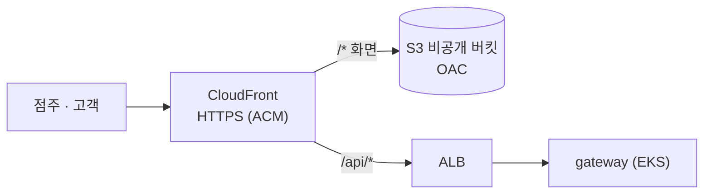

# frontend

> FreshLink의 **화면**. 점주 화면(`/owner`, 매장 포스기)과 고객 화면(`/customer`, 핸드폰)을 React 앱 하나에 담고, 라우팅으로 나눈다.

| 항목 | 내용 |
| --- | --- |
| 담당 | 공통 (레이아웃·라우팅: 김진아, 점주 재고 화면: 이태우, 로그인·고객 주문 화면: 김경우) |
| 기술 | Vite, React, TypeScript, React Router, Tailwind CSS, TanStack Query, axios, Zustand ([전체 목록과 이유](docs/tech-stack.md)) |
| 배포 | `main` 합치기 → GitHub Actions `npm run build` → S3 업로드 → CloudFront 캐시 무효화 |
| 접속 | CloudFront 주소 하나 (화면 `/*` → S3, API `/api/*` → EKS gateway) |

---

## 1. FreshLink는 무엇인가

편의점 점주와 고객이 **같은 재고 데이터**를 보는 서비스다. 고객이 결제하면 점주 화면의 재고가 그 자리에서 줄고, 유통기한이 지난 상품은 고객에게 보이지 않는다. 전체 소개는 [Organization README](https://github.com/sesac-freshlink)를 참고한다.

## 2. 배포 구조



화면과 API를 **같은 CloudFront 주소**로 묶었기 때문에 **CORS 설정이 필요 없다.** 프론트에서는 API를 항상 상대 경로 `/api/...`로 부른다.

주의할 점:

1. **새로고침:** `/owner/inventory`에서 새로고침해도 깨지지 않도록 CloudFront Function이 확장자 없는 경로를 `/index.html`로 바꿔 준다([infra](https://github.com/sesac-freshlink/infra) `frontend` 모듈).
2. **점주 재고:** 점주 재고 화면은 3초마다 `GET /api/owner/inventory`로 조회(폴링)한다. 고객이 결제하면 3초 안에 재고가 바뀐다. SSE는 inventory-service 파드가 2개라 Redis pub/sub가 있어야 해서 2순위로 미뤘다([이유](docs/tech-stack.md#실시간-재고는-폴링으로-한다-s-15)).
3. **주문 상태:** 고객 주문 상세는 2초마다 `GET /api/orders/{id}`로 조회(폴링)한다.

## 3. 화면 목록

| 경로 | 화면 | 기능 ID | 담당 |
| --- | --- | --- | --- |
| `/login`, `/signup` | 로그인·가입 | C-01, C-02 | 김경우 |
| `/customer` | 고객 홈 (점포 검색) | U-01 | 김경우 |
| `/customer/stores/:storeId` | 점포 상품 목록 | U-10 | 이태우 |
| `/customer/orders/:id` | 주문·결제·주문 상세 | U-21, U-22, U-31 | 김경우 |
| `/owner/inventory` | 재고 목록 (3초 폴링) | S-10, S-15 | 이태우 |
| `/owner/inventory/:productId` | lot 상세 | S-11 | 이태우 |
| `/owner/ledger` | 변동 이력 | S-13 | 이태우 |
| `/owner/expiring` | 임박·폐기 | S-30, S-32 | 이태우 |
| `/owner/orders` | 신규 주문 목록 | S-50 | 김경우 |

## 4. 폴더 구조

```
frontend/
├── public/
└── src/
    ├── app/            # 라우터, 공통 레이아웃 (김진아)
    ├── shared/         # API 클라이언트, 인증 토큰 보관, 공통 컴포넌트
    ├── auth/           # 로그인·가입 (김경우)
    ├── owner/
    │   ├── inventory/  # 재고·lot·이력·임박·폐기 (이태우)
    │   └── orders/     # 신규 주문 목록 (김경우)
    └── customer/
        ├── stores/     # 점포 검색·상품 목록
        └── order/      # 주문·결제·주문 상세 (김경우)
```

로그인 토큰(JWT)은 브라우저 메모리 + localStorage에 둔다(MVP 단순화). 로그아웃은 토큰 삭제다.

## 5. 로컬에서 실행하기

> 아직 뼈대만 있는 상태다. 첫 작업으로 Vite로 React 프로젝트를 만들고(`npm create vite@latest . -- --template react-ts`) 위 구조에 맞춰 넣는다.

```bash
npm install
npm run dev
```

개발 서버에서는 `/api` 요청을 로컬 gateway(`http://localhost:8080`)로 넘기도록 Vite proxy를 설정한다. 그래서 운영과 똑같이 상대 경로로 API를 부를 수 있다.

## 6. 브랜치와 기여

- `main`(배포) ← `dev`(통합, 기본 브랜치) ← `feat/<기능ID>-<설명>` (예: `feat/S-10-inventory-page`)
- 화면 폴더별 담당자가 CODEOWNERS로 표시된다. PR을 열면 그 폴더 담당자가 리뷰어로 지정된다. PR·승인은 필수가 아니어서 직접 push해도 된다.

자세한 규칙은 [.github 레포](https://github.com/sesac-freshlink/.github)를 참고한다.
